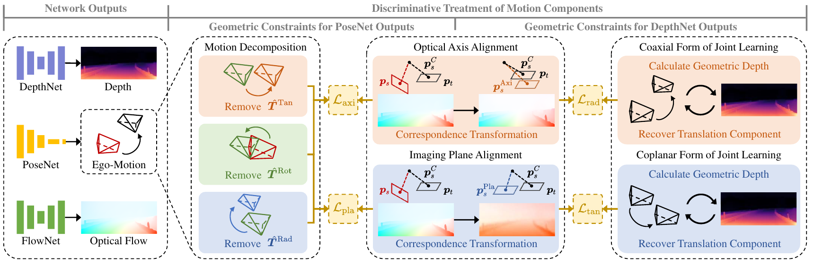

# DiMoDE: Discriminately Treating Motion Components Evolves Joint Depth and Ego-Motion Learning

Official PyTorch implementation for the paper:

> **Discriminately Treating Motion Components Evolves Joint Depth and Ego-Motion Learning**
>
> Mengtan Zhang, Zizhan Guo, Hongbo Zhao, Yi Feng, Zuyi Xiong, Yue Wang, Shaoyi Du, Hanli Wang, and Rui Fan
>
> IEEE Transactions on Pattern Analysis and Machine Intelligence (T-PAMI), 2026
>
> [Paper](https://doi.org/10.1109/TPAMI.2026.3732069) · [Project Page](https://mias.group/DiMoDE/)

DiMoDE exploits the geometric regularities of individual motion components to improve joint depth and ego-motion learning. Optical-axis and imaging-plane alignments introduce geometric constraints on pose and depth. Optical flow is used during training; inference requires only DepthNet or PoseNet.



This release includes **nuScenes monocular depth estimation** and **KITTI Odometry ego-motion estimation**, with training and evaluation scripts. Other experiments from the paper are outside this release.

## Table of Contents

- [Install](#install)
- [Dataset](#dataset)
- [Training](#training)
- [Evaluation](#evaluation)
- [Pretrained Models](#pretrained-models)
- [Acknowledgements](#acknowledgements)
- [Citation](#citation)

## Install

The implementation has been checked in the author's `dcpi_depth_env`: Python 3.9.25, PyTorch 2.0.1+cu117, and torchvision 0.15.2+cu117.

```bash
conda create -n dimode_env python=3.9
conda activate dimode_env
pip install torch==2.0.1+cu117 torchvision==0.15.2+cu117 --extra-index-url https://download.pytorch.org/whl/cu117
pip install -r requirements.txt
```

Alternatively, activate the existing environment with `conda activate dcpi_depth_env`. Run all commands below from the repository root. CUDA training requires a compatible NVIDIA GPU and driver. Batch sizes are editable in the plain shell scripts; reduce them to fit available memory. `--no_cuda --num_workers 0` enables CPU execution for small local checks.

## Dataset

Download the original datasets from [nuScenes](https://www.nuscenes.org/nuscenes) and [KITTI Odometry](https://www.cvlibs.net/datasets/kitti/eval_odometry.php). Data are not included in this repository.

### nuScenes

Use front-camera videos preprocessed into consecutively numbered JPEG frames. The preprocessing approach in [Dynamo-Depth](https://github.com/YihongSun/Dynamo-Depth) can be used as a starting point; the resulting folders and frame indices must match the supplied splits. This release consumes preprocessed data and does not include raw-data preprocessing or pseudo-depth generation.

| Path | Content |
| --- | --- |
| `data/nuscenes/training/scene-XXXX/000000.jpg` | Consecutive training/validation frames |
| `data/nuscenes/training/scene-XXXX/psedo_depth/000000.png` | Pseudo-depth for the corresponding frame, required by the supplied training command |
| `data/nuscenes/testing/color/000000.jpg` | Test images, numbered `000000` through `006018` |
| `data/nuscenes/testing/depth/000000.npy` | Corresponding point-depth array with shape `(N, 3)`: image `x`, image `y`, depth in meters |

Split files are in `splits/nuscenes/`: 79,760 training triplets, 6,019 validation entries, and 6,019 test images. Each line has the format `folder frame_index side`. Training and validation entries refer to scene folders under the **training root**. Test entries refer to `color` under the **testing root**. Point coordinates refer to the original 1600×900 image.

The supplied loader uses normalized camera intrinsics `fx=1.16, fy=1.92, cx=cy=0.5`, as in the original code. It does not read `cam.txt`. Keep the original camera/image convention when preparing data.

### KITTI Odometry

Download the **color image sequences** and the official ground-truth poses. Retain the original PNG names and both color cameras, since the training split uses left and right images.

| Path | Content |
| --- | --- |
| `data/kitti_odom/sequences/00/image_2/000000.png` | Left color images; sequences `00`–`10` |
| `data/kitti_odom/sequences/00/image_3/000000.png` | Right color images; sequences `00`–`08` used for training |
| `data/kitti_odom/poses/09.txt` | Official ground-truth trajectory for sequence 09 |
| `data/kitti_odom/poses/10.txt` | Official ground-truth trajectory for sequence 10 |

The split files in `splits/kitti_odom/` contain 36,671 training and 4,075 validation entries from sequences 00–08. Evaluation uses 1,590 consecutive image pairs for sequence 09 and 1,200 for sequence 10, producing 1,591 and 1,201 poses, respectively.

To use datasets stored elsewhere, set `NUSCENES_TRAIN_PATH`, `NUSCENES_TEST_PATH`, and `KITTI_ODOM_PATH` as shown below. No data need to be copied into the repository.

## Training

Prepare the initialization checkpoints listed in [weights/README.md](weights/README.md), then run:

```bash
# nuScenes: Lite-Mono, 640×384, 30 epochs
NUSCENES_TRAIN_PATH=/path/to/nuscenes/training bash scripts/train_nuscenes.sh

# KITTI Odometry: Lite-Mono-8m, 640×192, resume from weights_4
KITTI_ODOM_PATH=/path/to/kitti_odom bash scripts/train_kitti_odom.sh
```

The scripts retain the original commands and accept additional Python options at the end. For example:

```bash
KITTI_ODOM_PATH=/path/to/kitti_odom bash scripts/train_kitti_odom.sh --batch_size 8 --num_workers 4
```

Training outputs are saved under `tmp/<model_name>/`, including TensorBoard events and `models/weights_<epoch>/`. KITTI Odometry also evaluates sequences 09/10 every 1,000 updates and after each epoch, using `KITTI_ODOM_PATH/poses/` as ground truth. Use `--eval_dataset none --eval_frequency 0` to disable this evaluation, or specify `--eval_data_path` and `--gt_path` for separate evaluation data.

For resuming, `weights_4` starts at epoch 5 (zero-based); `--num_epochs 30` is the total target epoch count. `--resume_epoch` explicitly overrides the starting epoch. Full resume checkpoints include both model and optimizer states. The inference-only checkpoints below are not full training checkpoints.

**Training configuration:** these scripts retain the supplied implementation's settings, including RAFT-KITTI initialization, the existing geometric-loss schedule, pseudo-depth normal supervision for nuScenes, and KITTI's supplied epoch-4 initialization. These settings differ from the paper's description of FlyingChairs initialization and its 5/10/15-epoch progressive schedule. A complete retraining comparison against the released checkpoints remains to be verified; the scripts should not be treated as a verified from-scratch recipe for the paper's numbers.

## Evaluation

Place the inference checkpoints as described below, then run the two evaluation scripts:

```bash
NUSCENES_TEST_PATH=/path/to/nuscenes/testing bash scripts/test_nuscenes.sh
KITTI_ODOM_PATH=/path/to/kitti_odom bash scripts/test_kitti_odom.sh
```

nuScenes depth evaluation uses per-image median scaling and valid projected points with depth in `(0.001, 75)` meters. Predictions are resized to 1600×900 before sampling at the ground-truth points. Flip post-processing is disabled by default. Results are written to `eval/model-nuscenes/metrics.csv`; add `--save_pred_disps` to save predicted disparities.

KITTI evaluation predicts both complete test trajectories, then uses the [KITTI odometry evaluation toolbox](https://github.com/Huangying-Zhan/kitti-odom-eval) with **7-DoF alignment**. Predicted poses, metrics, error files, and plots are written to `eval/model-kitti_odom/`. Set `KITTI_ODOM_RESULTS` or `KITTI_ODOM_GT_PATH` to change the trajectory output or ground-truth directory.

## Pretrained Models

Checkpoints are distributed separately from Git. **Public download links are pending.** The checkpoint bundles and required destinations are documented in [weights/README.md](weights/README.md).

| Model | Task | Input size | Required files |
| --- | --- | --- | --- |
| DiMoDE (nuScenes) | Depth | 640×384 | `weights/dimode-nuscenes/{encoder,depth}.pth` |
| DiMoDE (KITTI Odometry) | Ego-motion | 640×192 | `weights/dimode-kitti-odom/{pose_encoder,pose}.pth` |

Reference results recorded with the supplied checkpoints:

| Dataset | Abs Rel ↓ | Sq Rel ↓ | RMSE ↓ | RMSE log ↓ | δ < 1.25 ↑ | δ < 1.25² ↑ | δ < 1.25³ ↑ |
| --- | --- | --- | --- | --- | --- | --- | --- |
| nuScenes | 0.13894 | 1.47151 | 6.25395 | 0.22585 | 0.83556 | 0.93874 | 0.97270 |

| KITTI sequence | Translation (%) ↓ | Rotation (deg/100m) ↓ | ATE (m) ↓ | RPE (m) ↓ | RPE (deg) ↓ |
| --- | --- | --- | --- | --- | --- |
| 09 | 2.861 | 0.740 | 9.835 | 0.044 | 0.045 |
| 10 | 4.203 | 1.220 | 5.816 | 0.047 | 0.055 |

The table lists the supplied checkpoints' reference results. CPU and CUDA execution or different numerical backends may produce small differences. The same split files, median-scaling protocol, and 7-DoF alignment must be used for comparison.

## Acknowledgements

Many thanks to [DCPI-Depth](https://github.com/mengtanZ/DCPI-Depth), [Lite-Mono](https://github.com/noahzn/Lite-Mono), [Monodepth2](https://github.com/nianticlabs/monodepth2), [RAFT](https://github.com/princeton-vl/RAFT), [SC-DepthV3](https://github.com/JiawangBian/sc_depth_pl), [Dynamo-Depth](https://github.com/YihongSun/Dynamo-Depth), and the [KITTI odometry evaluation toolbox](https://github.com/Huangying-Zhan/kitti-odom-eval). A compatible no-warmup cosine scheduler is included so that training does not depend on an untracked local module.

See [LICENSE](LICENSE) and [third-party notices](THIRD_PARTY_NOTICES.md) for attribution and upstream terms.

## Citation

If you find our work useful in your research, please consider citing our paper:

```bibtex
@article{zhang2026dimode,
  title={Discriminately Treating Motion Components Evolves Joint Depth and Ego-Motion Learning},
  author={Zhang, Mengtan and Guo, Zizhan and Zhao, Hongbo and Feng, Yi and Xiong, Zuyi and Wang, Yue and Du, Shaoyi and Wang, Hanli and Fan, Rui},
  journal={IEEE Transactions on Pattern Analysis and Machine Intelligence},
  year={2026},
  doi={10.1109/TPAMI.2026.3732069},
  publisher={IEEE}
}
```
